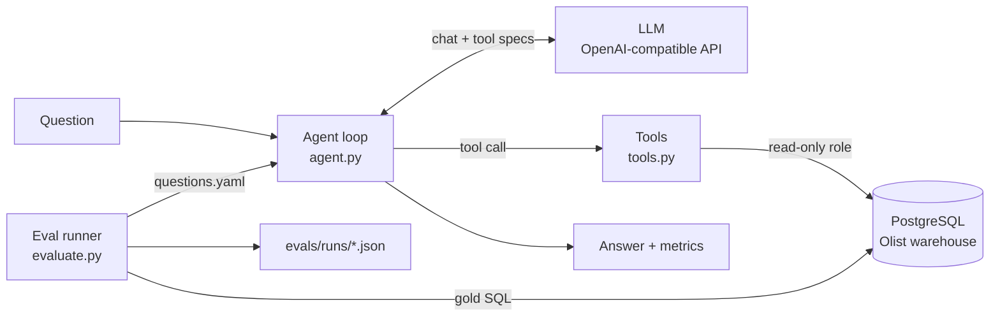

# Olist SQL Agent

An LLM agent that answers natural-language questions about the
[Olist e-commerce dataset](https://www.kaggle.com/datasets/olistbr/brazilian-ecommerce)
by exploring a PostgreSQL schema, writing SQL, running it, and explaining the result.
It comes with a repeatable evaluation suite that measures accuracy, response time
and token usage, and records every run together with the prompt, model and dataset
version that produced it.

```
$ olist-ask "How many orders have the status 'canceled'?"
[tool] list_tables {}
[tool] describe_table {"schema":"02_stg","table":"stg_orders"}
[tool] run_sql {"query":"SELECT COUNT(*) AS canceled_orders FROM \"02_stg\".stg_orders WHERE order_status = 'canceled';"}
The database shows **625** orders with the status **'canceled'**.
(4 LLM calls, 1796 tokens, 6.5s)
```

## Architecture



1. The agent sends the question, a versioned system prompt and three tool specs to the LLM.
2. The LLM replies either with tool calls or with a final answer. Tool calls are run and
   their results are sent back; the loop stops at the answer or after 10 steps.
3. The tools are plain Python functions that return text:
   - `list_tables` lists the tables in the allowed schemas.
   - `describe_table` lists the columns with their types and notes on columns whose
     name does not tell the whole story (for example `item_total_amount = price + freight_value`).
   - `run_sql` runs a query and returns at most 50 rows. Errors come back as text
     so the LLM can read them and correct its query.

### Project layout

```
src/olist_agent/
  db.py         connection, read-only transaction, statement timeout
  tools.py      the three tools, their JSON specs, and the dispatcher
  agent.py      the agent loop and the per-question metrics
  cli.py        olist-ask
  evaluate.py   olist-eval and olist-report
prompts/        versioned system prompts (v1.txt, v2.txt)
evals/
  questions.yaml   20 questions with gold SQL
  runs/            one JSON file per eval run
tests/          unit tests (pytest)
```

## How to run

Requirements: Python 3.11+, a PostgreSQL database with the Olist warehouse
(schemas `02_stg` and `03_data_warehouse`, built by a separate dbt project),
and an API key for any OpenAI-compatible LLM endpoint. I used the Groq free tier.

```bash
python -m venv .venv
source .venv/bin/activate
pip install -e ".[dev]"
```

Create a `.env` file:

```
PGHOST=localhost
PGPORT=5432
PGDATABASE=olist_database
PGUSER=olist_agent
LLM_BASE_URL=https://api.groq.com/openai/v1
LLM_API_KEY=your-key
LLM_MODEL=openai/gpt-oss-120b
```

Then:

```bash
olist-ask "Which month of 2017 had the most orders?"
olist-eval v2        # run the eval suite with prompt v2
olist-report         # one line per saved eval run
pytest               # all tests (needs the database)
pytest -m "not db"   # tests that need neither the database nor an LLM
```

### Docker

```bash
docker build -t olist-sql-agent .
docker run --rm --env-file .env -e PGHOST=host.docker.internal \
    olist-sql-agent "How many orders have the status 'canceled'?"
```

The image runs `olist-ask`. The database stays outside the container, and the API key
is passed at run time, never built into the image. The eval runner is meant to be run
from a git checkout, because each run records the current commit.

### Database role

The agent connects as a role that can only `SELECT`:

```sql
CREATE ROLE olist_agent LOGIN;
GRANT CONNECT ON DATABASE olist_database TO olist_agent;
GRANT USAGE ON SCHEMA "02_stg", "03_data_warehouse" TO olist_agent;
GRANT SELECT ON ALL TABLES IN SCHEMA "02_stg", "03_data_warehouse" TO olist_agent;
ALTER DEFAULT PRIVILEGES FOR ROLE postgres IN SCHEMA "02_stg", "03_data_warehouse"
    GRANT SELECT ON TABLES TO olist_agent;
```

## Evaluation

### Method

`evals/questions.yaml` holds 20 questions, each with a hand-written gold SQL query.
For each question, the runner:

1. asks the agent,
2. takes the last `run_sql` query the agent ran without an error,
3. runs both that query and the gold query against the database,
4. compares the two results.

This is **execution accuracy**: the agent is graded on what its SQL returns, not on
how the SQL is written, because many different queries are correct.

Comparison rules:

- Numbers are rounded to 2 decimals.
- Each agent row must contain every value of the matching gold row. Extra columns and
  column order are ignored, so an agent that also returns a label is not penalised.
- Both results must have the same number of rows; row order is ignored.

Every run is saved to `evals/runs/<timestamp>.json` with the model, prompt version,
SHA-256 of the prompt text, git commit, dataset version, per-question metrics, the
agent's SQL and its answer. Prompt files are never edited once used; a change becomes a
new version. Run files are committed, so the results below can be traced to the exact
code and prompt that produced them.

### Results

20-question dataset (`dataset_version: 3`), from `olist-report`:

| Model | Prompt | Accuracy | Avg tokens / question | Avg seconds / question |
|---|---|---|---|---|
| gpt-oss-120b | v1 | 19/20 | 2,534 | 14.5 |
| gpt-oss-120b | v2 | 20/20 | 2,717 | 13.9 |
| gpt-oss-20b | v2 | TODO | TODO | TODO |

Earlier runs on a 9-question dataset (3 runs per prompt):

| Prompt | Accuracy per run | Total | Questions answered from staging tables, per run |
|---|---|---|---|
| v1 | 9/9, 9/9, 7/9 | 25/27 | 4, 4, 6 |
| v2 | 8/9, 9/9, 8/9 | 25/27 | 1, 1, 1 |

Seconds include waiting for the free tier's per-minute rate limit, so they measure
the setup as a whole, not only the model.

### What the eval found

- **Accuracy alone could not tell the prompts apart.** The same prompt moved by one
  question between identical runs, which is as large as the difference between v1 and v2.
  A single run per prompt would have supported either conclusion.
- **Prompt v2 changed behaviour consistently.** It tells the agent to prefer the
  warehouse and its precomputed business columns. Staging-table use dropped from 4–6
  questions per run to only the question that needs a staging-only column. This
  matters because v1 sometimes recomputed "late delivery" from timestamps and got
  7,827 instead of the warehouse's definition (6,534, compared by date).
- **Join fan-out.** Joining customers on `customer_unique_id` duplicates rows because
  that column is not unique in the customer table. A general prompt rule did not stop
  this; a note on the column in `describe_table` reduced it but did not remove it.
- **Ambiguous column names.** The agent once summed `item_total_amount` for a question
  that excluded freight. Column notes now state what such columns contain.
- **Arithmetic outside SQL.** In one run the agent queried the correct counts and then
  divided them itself, answering 6.78% instead of 6.77%.

### Limitations

- 20 questions and one or two runs per configuration are too few to detect small
  differences; the results above show trends, not significant gains.
- Column notes and prompt v2 were written after looking at failures on this dataset,
  so scores on it are optimistic. New questions are the fair test.
- The SQL is graded, not the written answer. An agent that runs the right query and
  then misreports it is still counted as correct (the arithmetic case above was caught
  only because its last query returned counts, not the percentage).
- Gold queries return only values with one unambiguous representation; questions are
  worded to have one interpretation.

## Design decisions

- **OpenAI-compatible client.** The `openai` SDK with a configurable `base_url` works with
  Groq, OpenAI and Ollama, so the provider is a `.env` change.
- **Tools return text, including errors.** The LLM reads SQL errors and fixes its query
  instead of the program crashing.
- **Defence in depth for the database.** A `SELECT`-only role, a read-only transaction,
  a 10-second statement timeout, and a 50-row result cap. The role is the real guarantee;
  a read-only transaction alone can be bypassed with a multi-statement query.
- **Execution accuracy with strict row counts.** Strict rules produce false negatives
  that are visible when reading failures, rather than false positives that hide errors.
- **Rate limits.** Per-minute limits are retried by the SDK using the server's
  `retry-after`; a daily limit stops the eval run without saving a partial result.

## Tests and CI

- 23 unit tests. Tests of the agent loop use a fake LLM client with scripted responses,
  so they need neither network access nor the database.
- Tests that need the database are marked `db`. GitHub Actions runs
  `pytest -m "not db"` on every push, since the Olist database is not available in CI.

## Next steps

- Prompt v3: do all arithmetic in SQL.
- More questions, especially ones not used while tuning the prompt and column notes.
- Several runs per configuration, reporting the spread.
- A small seeded database in CI so the database tests run there too.
